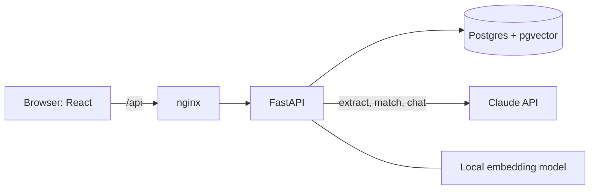
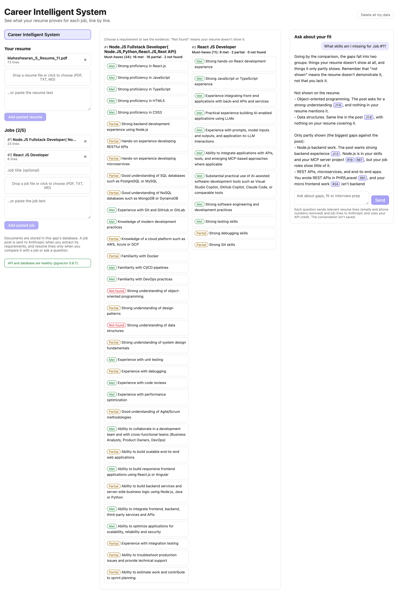

# Career Intelligent System

See what your resume proves for each job, requirement by requirement.

Add one resume and up to five job posts. Career Intelligent System lists each job's requirements, marks each one **met**, **partial** or **not found** with the resume lines behind it, shows the jobs side by side, and answers questions such as "What skills am I missing for this role?" or "How does my experience align with Job #2?" with cited lines.

Contents: [Setup](#quick-setup) · [Architecture](#architecture) · [RAG and LLM approach](#rag-and-llm-approach) · [Decisions](#key-technical-decisions-and-why) · [Production](#taking-it-to-production) · [Standards](#engineering-standards) · [AI tools](#how-ai-tools-were-used-in-development) · [With more time](#what-id-do-differently-with-more-time)

## Quick setup

Needs Docker, and an Anthropic API key for everything that uses the model.

```bash
cp .env.example .env
```

Put your key after `ANTHROPIC_API_KEY=` in `.env`, then:

```bash
docker compose up --build
```

Open <http://localhost:5180>. The API docs are at <http://localhost:8100/api/docs>.

Then: add your resume, add a job (PDF, TXT, MD or pasted text), press the button to extract its requirements, press the button to compare, and ask a question. Extracting, comparing and asking are billed to your key. Nothing calls the model on its own.

### Configuration

- `ANTHROPIC_API_KEY`: the job post is sent to Anthropic when you extract, your whole resume when you compare, and relevant resume and job lines, with your question and recent turns, when you chat. Emails and phone numbers are removed from document lines and earlier turns, but not from the question you are typing. This is not anonymisation.
- `FITGRID_MODEL`: optional, default `claude-sonnet-5-5`.
- Host ports and the local database password, if the defaults clash.

After changing `.env`, run `docker compose up -d` again.

### Run for development

Needs Python 3.12 with [uv](https://docs.astral.sh/uv/), Node 24 and pnpm. Only the database runs in Docker.

```bash
docker compose up -d db
```

```bash
cd apps/api && uv sync && uv run --env-file ../../.env uvicorn app.main:app --reload --port 8100
```

```bash
cd apps/web && pnpm install && pnpm dev
```

The first chat question downloads the embedding model; the Docker image already contains it.

### Checks

```bash
cd apps/api && uv run ruff check . && uv run ruff format --check . && uv run pytest
```

```bash
cd apps/web && pnpm typecheck && pnpm lint && pnpm test && pnpm build
```

The API tests need Postgres running; without it the database tests are skipped. No test calls a paid API. CI runs these on every branch, plus a Docker Compose smoke test. After changing an API model, run `bash scripts/gen-types.sh`.

## Architecture



```
upload ─> parse into numbered lines ─> store
job    ─> extract requirements (must / nice) ─> check cited lines ─> store
match  ─> requirements + whole resume ─> verdicts ─> check cited lines ─> store
chat   ─> pick jobs ─> their verdicts + nearest lines ─> streamed, cited answer
```

## RAG and LLM approach

### Model & Infrastructure Choices
LLM: Claude Sonnet 5.5 — Chosen over Opus for cost-efficiency.

Embeddings: BAAI/bge-small-en-v1.5 via fastembed run locally — Keeps resume data local and avoids sending PII to a secondary embedding vendor.

Vector Store: pgvector inside PostgreSQL — Avoids operational overhead of managing a separate vector database; vectors live and die with their parent records.

Orchestration: Plain Python scripts — No heavy frameworks (like LangChain) needed for a deterministic, linear parsing pipeline.

### Retrieval Strategy
Matching: Sends the entire resume to the model when checking job requirements. Skipping even one bullet point during a search could falsely mark a real skill as missing.

Chat: Pulls only what is relevant to your question—combining the job's requirements and verdicts with the top 12 matching resume lines, 10 matching job lines, and any lines already cited in the verdicts.

### Guardrails

Emails and phone numbers are removed before leaving the server, and raw document text is never written to application logs.

Paid model calls only run on explicit button clicks, input sizes are strictly capped, and prompts forbid inferring protected attributes.

Every requirement and verdict must cite a real line number; invalid citations are dropped or marked "not found" in code.

Document text is wrapped in escaped XML tags (<document_text>) so uploaded files are treated strictly as data, not instructions.


## Key technical decisions and why
Full-Resume Matching over Chunk Retrieval: Prioritises absolute accuracy over token savings. False negatives on skills hurt user trust immediately.

Line-Number Citations Checked in Code: Forces the model to anchor every claim to a specific numbered line, minimising hallucinated qualifications.

PostgreSQL as Single Source of Truth: Storing relational tables and vector embeddings in one Postgres instance simplifies migrations, transactions, and backups.

## Taking it to production

To transition this single-machine app into a multi-tenant production system on AWS, the architecture requires following concerns:

| Part | Service |
| --- | --- |
| Frontend | S3 + CloudFront |
| API | ECS Fargate behind a load balancer, idle timeout raised for streaming and long calls |
| Database | Amazon RDS |
| Securities & Secrets | Amazon Secrets Manager, Cognito |
| Logs and metrics | CloudWatch |
| Model | Anthropic's API, or Claude on Amazon Bedrock after checking which request options work there |
| Async Processing | SQS + Workers

## Engineering standards
Followed: Strict Pydantic request/response validation, parameterized SQL queries prevent injection, Ruff for Python linting/formatting, TypeScript strict mode on the frontend, non-root Docker execution, and isolation of secrets via .env.

Skipped (for speed): End-to-end browser testing with Playwright, full database migration workflows (kept Alembic minimal), and automated frontend type-generation pipelines in CI.

## How AI tools were used in development
Claude Code acted as the primary coding partner, writing boilerplate, test skeletons, and draft implementations. As the developer, I retained full architectural control—defining system boundaries, selecting pdfplumber for robust two-column PDF parsing, vetting token usage, and reviewing all security boundaries before committing.

## What I'd do differently with more time
Test with real data before tweaking prompts: Right now, prompt changes rely mostly on manual spot-checks. With more time, I’d build a proper set of sample resumes and job posts with expected answers so I can measure if a prompt change actually improves accuracy or just breaks something else.

Move heavy work to the background: Currently, extracting requirements and matching resumes happen while the user waits for the page to load. Moving these slow LLM calls to a background queue (like Celery or AWS SQS) would keep the app fast and prevent timeouts on larger files.

Group similar skills across jobs: When comparing 4 or 5 job posts, the same core requirements (like "React" or "REST APIs") show up repeatedly. Merging overlapping requirements into a single view would make it much easier to see which skills carry the most weight across roles.

## Screenshot
